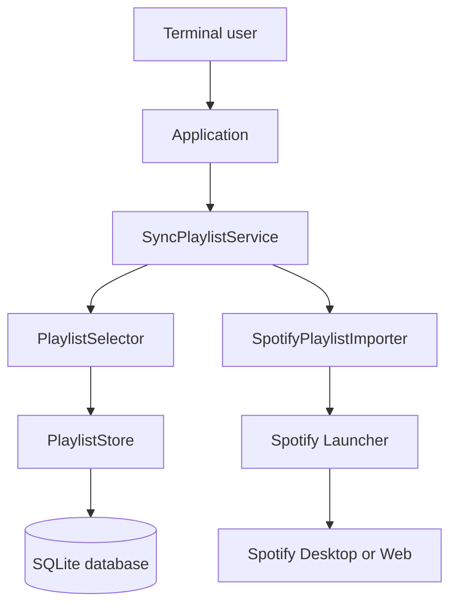

# MusicSync

[](https://github.com/JosephGrayston/MusicSync/actions/workflows/build.yml)

A .NET console app for organizing and syncing Spotify playlists.

---

## About

MusicSync provides a terminal interface for creating, naming, selecting, and storing playlists. It persists playlist records in SQLite and opens Spotify in the desktop app or the web player when it starts a sync action.

> [!WARNING]
> Playlist track import is under development. The current Spotify step opens Spotify and asks the user to copy tracks to the clipboard; clipboard parsing and persistence are not yet implemented.

---

## Features

- Create uniquely named playlists.
- Select from existing playlists through an interactive terminal prompt.
- Store playlists and creation timestamps in SQLite.
- Open Spotify Desktop or Spotify Web.
- Write application logs to a local log directory.

---

## Tech Stack

- C# and .NET 10
- .NET Generic Host and dependency injection
- Entity Framework Core with SQLite
- Spectre.Console
- Serilog
- MSTest and Shouldly
- GitHub Actions

---

## Architecture



At startup, the app applies pending EF Core migrations, opens the selected action in the terminal, and creates the local data and log directories for the current user.

---

## Project Structure

```text
MusicSync/
  Application.cs                 Application entry workflow
  Playlists/                     Playlist prompts, selection, and persistence
  Spotify/                       Spotify launch and playlist import workflow
  Infrastructure/
    Persistence/                 EF Core database and migrations
    Logging/                     Serilog integration
    Terminal/                    Console presentation helpers
MusicSync.UnitTests/             MSTest unit tests
.github/workflows/build.yml      CI build and test workflow
```

---

## Getting Started

**Needs verification:** Setup and run instructions have not yet been exercised end to end in this environment.

### Prerequisites

- [.NET 10 SDK](https://dotnet.microsoft.com/download/dotnet/10.0)
- Spotify Desktop or a browser with access to [Spotify Web](https://open.spotify.com/)

### Build and run

```powershell
git clone https://github.com/JosephGrayston/MusicSync.git
cd MusicSync
dotnet restore
dotnet build
dotnet run --project .\MusicSync\MusicSync.csproj
```

### Run the tests

```powershell
dotnet test .\MusicSync.UnitTests\MusicSync.UnitTests.csproj
```

---

## Configuration

MusicSync currently reads the `Serilog` settings from [`MusicSync/appsettings.json`](./MusicSync/appsettings.json). No API keys or user secrets are required for the current implementation.

The app stores runtime files under the current user's local application-data directory:

- Database: `%LOCALAPPDATA%\MusicSync\musicsync.db`
- Logs: `%LOCALAPPDATA%\MusicSync\logs\`

---

## What's Next

- Read Spotify playlist tracks from the clipboard.
- Parse and persist imported tracks.
- Add a complete playlist synchronization workflow.
- Improve test coverage around playlist and Spotify behavior.

---

## Author

[Joseph Grayston](https://github.com/JosephGrayston)